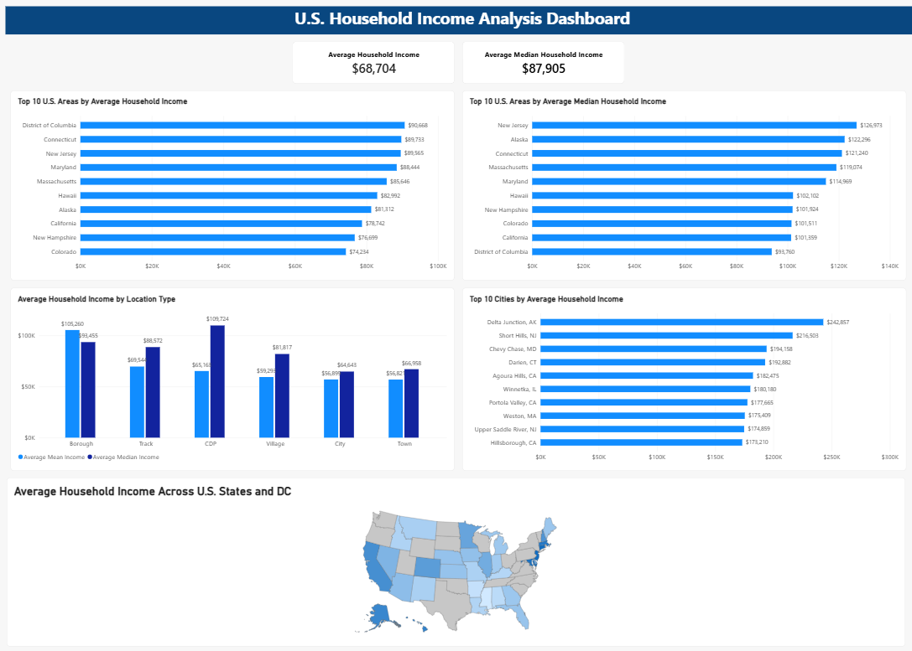

# U.S. Household Income Power BI Dashboard

An interactive Power BI dashboard analyzing U.S. household income patterns across states, cities, and location types.

## Dashboard Overview



## Project Overview

This project uses Power BI to transform U.S. household income data into an interactive dashboard that makes geographic and location-based income patterns easier to understand.

The dashboard highlights differences in average and median household income across U.S. states, cities, and location types.

## Key Metrics

- **Average Household Income:** $68,704
- **Average Median Household Income:** $87,905

## Dashboard Visuals

The dashboard includes:

- Top 10 U.S. areas by average household income
- Top 10 U.S. areas by average median household income
- Average household income by location type
- Top 10 cities by average household income
- U.S. state income map using average household income
- KPI cards for overall average and median household income

## Key Insights

- Household income varies considerably across U.S. states and cities.
- The District of Columbia, Connecticut, and New Jersey rank among the highest areas by average household income.
- New Jersey ranks highest in the dashboard for average median household income.
- Delta Junction, Alaska appears as the highest-income city in the city-level analysis.
- Household income also varies across different location classifications such as boroughs, CDPs, cities, towns, tracks, and villages.

## Tools Used

- Power BI Desktop
- Power Query
- DAX / Power BI calculations
- Microsoft Excel / CSV
- MySQL
- GitHub

## Skills Demonstrated

- Data preparation and transformation
- Data visualization
- KPI development
- Geographic data visualization
- Dashboard design and layout
- Filtering and aggregation
- Business intelligence reporting
- Data storytelling

## Repository Structure

```text
us-household-income-power-bi-dashboard/
├── US-Household-Income-Power-BI-Dashboard.pbix
├── README.md
└── Screenshots/
    └── dashboard-overview.png
```

## Author

Hamzah  
GitHub: [hamzaha-bot](https://github.com/hamzaha-bot)